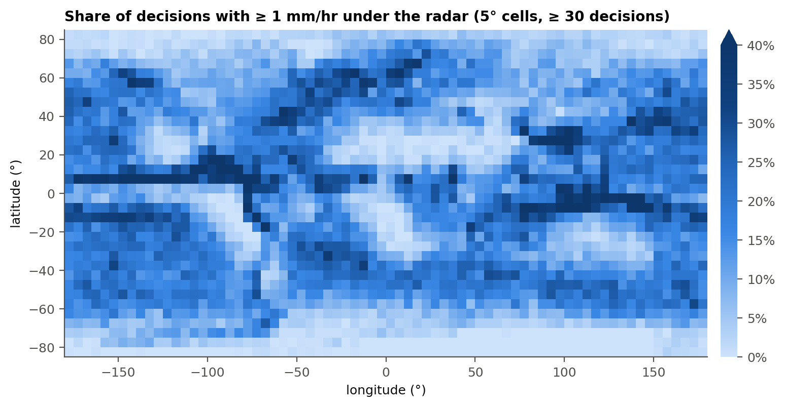
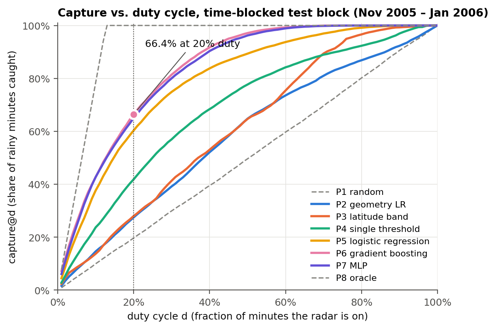
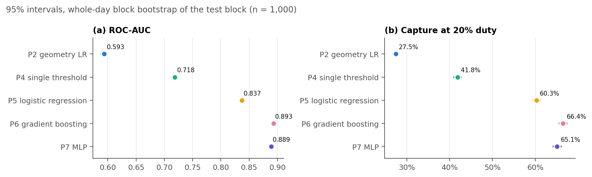
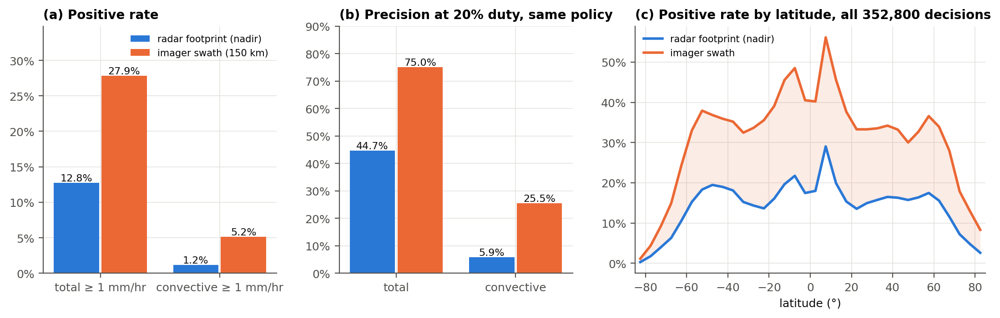
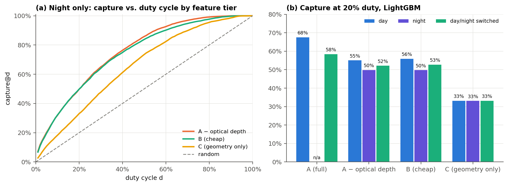
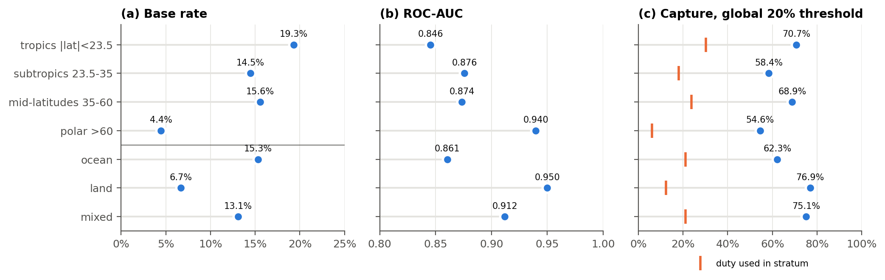
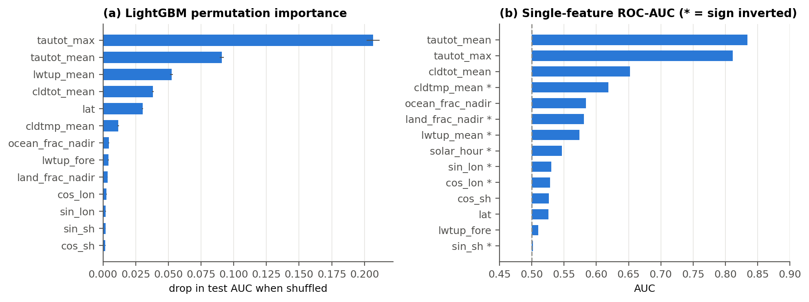
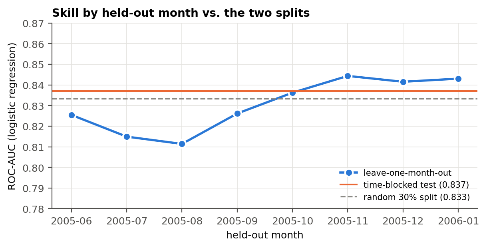

# 15. EarthCARE Results Report

This section collects the finished EarthCARE results in one place: the figures, the summary tables,
what each experiment showed, and whether it answered its research question. All numbers come from
`missions/earthcare/results/` (run of E1–E11 with P7, seed 0, dataset SHA-256
`9fe09a93c8b0640f73f23d8422f869573ca172c90c242a4536fdd08a3eb82424`). Every figure is drawn from those
files by

    python -m baselines.paper_figures --mission earthcare

into `docs/baseline_paper/figures/earthcare/`. The detailed tables are in `07_experiments.md`, the
written discussion in `10_results_and_discussion.md`, and every number with its source in
`13_key_numbers.md`.

**Setup in one paragraph.** 352,800 one-minute radar on/off decisions along EarthCARE's real ground
track (June 2005 – January 2006 of G5NR). Label: precipitation ≥ 1 mm/hr under the CPR's nadir line.
Inputs: 13 passive features from the 150 km MSI swath plus orbit geometry (Tier A). Split by weather
time: train June–September, validate October, test November – January (133,350 decisions, base rate
12.8%). Main metric: capture@d, the share of rainy minutes the gate fires on when the radar may run
for a fraction *d* of minutes.

---

## 15.1 Verdict: was the experiment successful?

**Yes, on all four EarthCARE research questions.** The benchmark is built, every experiment E1–E11
ran, and each result is clear and statistically secure. It also has limits, listed in §15.9, and
those belong in the paper.

| research question | outcome | evidence | verdict |
|---|---|---|---|
| **RQ1:** can passive context predict rain under the nadir radar without temporal leakage? | AUC 0.893 [0.891, 0.896]; random vs. time-blocked split differ by only 0.004 AUC; every held-out month 0.887–0.907 (LightGBM); summer-only training costs ≤ 0.014 AUC on winter | E1, E2, E10 | ✅ answered: yes |
| **RQ2:** how much rain does a gate catch under a budget? | 66.4% of rainy minutes at 20% duty: 3.4× random (19.7%), 2.4× geometry-only (27.5%) | E3, E10 | ✅ answered: strong skill, with 33.6 points of headroom left for RL |
| **RQ3:** does scoring against the imager swath distort results? | positive class 2.2× larger (13.7% → 30.0%); precision inflated from 44.7% to 75.0% | E4 | ✅ answered: yes, strongly |
| **RQ4:** is it feasible onboard, and does it work at night? | night-capable inputs keep 89–90% of capture; policies need 16–18,300 parameters, ~1 ms per decision | E5, E9 | ✅ answered: yes, timed on a laptop only (§15.9) |
| **RQ5:** how do the missions compare? | needs TRMM and/or GPM | E12 | ⏳ not yet possible |

What counts as success here: the paper is a **benchmark** paper. It succeeds when it gives a clean,
leakage-free bar for an RL policy to beat and explains what sets that bar. It does not need the
static gate to be perfect, and the gap to the oracle is the room RL has to work in. On that standard
EarthCARE succeeded. The bar for RL is **LightGBM: 66.4% capture at 20% duty (50.8% at 13%), AUC
0.893**, on the November–January test block.

---

## 15.2 Where the radar sees rain (dataset)

**Figure 2.** Share of decisions with ≥ 1 mm/hr under the CPR, in 5° cells with at least 30
decisions (all 352,800 decisions). The ITCZ, the mid-latitude storm tracks of both hemispheres, and
the dry subtropical highs (eastern Pacific, Sahara–Arabia, southern Africa) show up clearly, as does
the outline of South America. Two parallel rain bands either side of the equator in the
eastern Pacific match G5NR's known split-ITCZ bias (Limitation: one model). Polar cells are dry,
which is why the polar stratum has the lowest base rate (4.4%).

## 15.3 Main result: capture under a budget (E3, E10)

**Figure 3.** Capture vs. duty cycle on the time-blocked test block. Grey dashed lines: random
(diagonal) and oracle (reaches 100% at d = 12.8%, the base rate). Precision lift is the E3 `lift`
column: precision at 20% duty divided by the base rate. "3.4× random" in the text is a different
ratio: LightGBM's capture divided by random's (66.4% / 19.7%).

| policy | AUC [95% CI] | capture@13% | capture@20% | mass-capture@20% | precision lift@20% |
|---|---|---|---|---|---|
| P1 random | 0.501 | 12.9% | 19.7% | 20.2% | 1.0× |
| P2 geometry LR | 0.593 [0.589, 0.598] | 18.2% | 27.5% | 31.8% | 1.4× |
| P3 latitude band | 0.629 | 18.5% | 28.0% | 34.5% | 1.4× |
| P4 single threshold | 0.718 [0.715, 0.722] | 29.0% | 41.8% | 53.1% | 2.3× |
| P5 logistic regression | 0.837 [0.834, 0.840] | 45.5% | 60.3% | 71.7% | 3.2× |
| **P6 LightGBM** | **0.893 [0.891, 0.896]** | **50.8%** | **66.4%** | **72.7%** | **3.5×** |
| P7 MLP 64-64 | 0.889 [0.887, 0.891] | 50.4% | 65.1% | 71.8% | 3.5× |
| P8 oracle | 1.000 | 100% | 100% | 91.7% | 5.0× |

What this shows:
- **Passive context carries real information.** LightGBM catches 3.4× as many rainy minutes as
  random gating at the same radar on-time.
- **Geometry alone is not enough.** Knowing where the satellite is (latitude, surface, local time)
  gives only 27–28%, so the gain comes from what the imager sees.
- **The decision is not one-dimensional.** The best single-feature rule (optical depth by day,
  cloud-top temperature by night) reaches 41.8%, 24.6 points below LightGBM.
- **Non-linear models help, but the choice between them barely matters.** LightGBM beats logistic
  regression by 6.1 points [5.3, 7.0]. It beats the MLP by only 1.4 points [0.8, 2.0] at 20%, and at
  13% the two are statistically tied (+0.4 [−0.1, +0.9]).
- **The gate favours heavy rain.** It catches 72.7% of the rain amount against 66.4% of rainy
  minutes.

**Figure S1.** 95% intervals from 1,000 whole-day resamples of the test block. The intervals are
narrow (±0.3 AUC points, ±0.8 capture points), so every ranking except P6 vs. P7 at 13% duty holds
up under resampling.

## 15.4 Label geometry: radar footprint vs. imager swath (E4)

**Figure 4.** (a) Test-block positive rate when the label is taken under the radar (nadir) vs. over
the whole 150 km imager swath. (b) Precision at 20% duty of the *same* nadir-trained LightGBM,
scored against each label. (c) Positive rate by latitude over the whole dataset; the shaded gap is
swath "rain" the radar could not have measured.

| label | positive rate nadir / swath | swath positives with no rain under the radar | precision@20% nadir / swath | capture@20% nadir / swath | AUC range |
|---|---|---|---|---|---|
| total ≥ 1 mm/hr | 12.8% / 27.9% (whole set 13.7% / 30.0%) | 54.2% | 44.7% / 75.0% | 66.4% / 51.1% | 0.890–0.899 |
| convective ≥ 1 mm/hr | 1.2% / 5.2% | 77.3% | 5.9% / 25.5% | 98.8% / 97.1% | 0.957–0.965 |

The finding: a study that scored EarthCARE's radar against swath truth would report the radar finding
rain on 75% of its on-time when the real figure is 45%. More than half of "rainy" swath minutes have
no rain where the radar points. Ranking quality (AUC) barely changes, so the label choice changes
the *reported numbers*, not which scenes the policy prefers. The gap is present at every latitude
(panel c) and is widest in the tropics.

## 15.5 Onboard feasibility: feature tiers, day and night (E5, E9)

**Figure 5.** (a) Night-only capture curves per feature tier. (b) Capture at 20% duty by day, by
night, and with the gate switching between day and night inputs.

| tier (LightGBM) | inputs | day | night | switched | retention vs. A |
|---|---|---|---|---|---|
| A (full) | 13 | 67.6% | n/a (optical depth is daylight-only) | 58.5% | 100% |
| A − optical depth | 11 | 55.1% | 49.8% | 52.1% | 89.2% |
| B (cheap: cloud-top temperature, longwave, geometry) | 10 | 55.9% | 49.8% | 52.7% | 90.2% |
| C (geometry only) | 7 | 33.2% | 33.1% | 33.2% | 56.7% |

| policy (E9) | parameters | size | operations per decision | wall time (Python, laptop) |
|---|---|---|---|---|
| P2 geometry LR | 8 | 2.8 kB | ~7 multiply-adds + sigmoid | 0.85 ms |
| P5 logistic regression | 16 | 3.3 kB | ~15 multiply-adds + sigmoid | 0.83 ms |
| P7 MLP | 5,249 | 134 kB | ~5,120 multiply-adds | 1.30 ms |
| P6 LightGBM | 18,300 | 1.05 MB | ~3,346 comparisons (300 trees) | 1.06 ms |

Result: useful gating does **not** need onboard cloud retrievals. Infrared-like inputs (Tier B) keep
90% of full-feature capture and match the richer tier exactly at night. Optical depth is worth about
12 points, by day only. Every policy decides in about 1 ms against a 60 s decision interval, so the
policy itself is not the bottleneck; computing the input features is.

## 15.6 Where the gate works and where it struggles (E6)

**Figure 6.** Base rate, AUC and capture at 20% duty per stratum, using one global threshold. Orange
ticks show how much of its radar time the gate spends in each stratum.

- **Best:** land (AUC 0.950, capture 76.9%) and mixed coasts (0.912, 75.1%).
- **Hardest to rank:** the tropics (AUC 0.846), where rain is most common (19.3%) and comes from
  convection that the imager sees mostly as deep cloud.
- **Lowest capture:** polar regions (54.6%) despite the *highest* AUC (0.940). Rain there is rare
  (4.4%), so a single global threshold gives them only 6.2% duty. A per-region threshold or a
  sequential policy could recover this, which makes it a concrete target for RL.

## 15.7 What drives the gate (E11)

**Figure S2.** (a) Drop in test AUC when each feature is shuffled. (b) AUC of each feature on its
own; * means a lower value predicts rain.

Optical depth dominates (`tautot_max` 0.207, `tautot_mean` 0.091 AUC drop), then outgoing longwave
(0.052), cloud fraction (0.038) and latitude (0.030). Orbit timing and longitude contribute almost
nothing. This matches the physics: thick, cold, high clouds are where a radar finds precipitation.

## 15.8 Robustness (E1, E2, E7, E8)

**Figure S3.** AUC for each held-out month (solid; trained on the other seven) for P5–P7, against
each model's time-blocked test score (dashed; trained Jun–Sep only, scored Nov–Jan, shaded).

- **No leakage inflation (E1).** A random split gives AUC 0.833 against 0.837 time-blocked, as
  expected from the short memory of nadir rain (lag-1 autocorrelation 0.106).
- **A small seasonal penalty, larger for flexible models (E2).** Training only on Jun–Sep and testing
  on Nov–Jan crosses a season. Holding out each winter month instead, with the other winter months
  in training, shows what that costs:

  | policy | Nov–Jan AUC, trained Jun–Sep | Nov–Jan AUC, trained on the other 7 months | gain | AP gain | AUC over all 8 held-out months |
  |---|---|---|---|---|---|
  | P5 logistic regression | 0.837 | 0.843 | +0.006 | 0.408 → 0.417 | 0.811–0.844 |
  | P6 gradient boosting | 0.893 | 0.905 | +0.012 | 0.544 → 0.581 | 0.887–0.907 |
  | P7 MLP | 0.889 | 0.903 | +0.014 | 0.527 → 0.569 | 0.879–0.905 |

  The flexible models gain about twice as much as LR from seeing winter, consistent with them
  learning some season-specific latitude patterns on top of the cloud physics. The gain is an upper
  bound on the seasonal effect: the month-held-out models also train on 7 months instead of 4. The
  penalty does not change the ranking (P6 ≥ P7 > P5 in every month), and the time-blocked numbers
  reported elsewhere are the conservative ones. The northern summer months are the hardest to
  predict for every model.
- **Threshold-independent ranking (E7).** LightGBM beats logistic regression on all five labels (AUC
  0.893–0.957). Rare targets rank well but are hard to catch: at a budget equal to their frequency
  the gate catches 41.1% of ≥ 5 mm/hr minutes and 30.4% of convective minutes.
- **Clean data (E8).** 0 invalid labels. 28,608 rows have a missing feature (cloud-top temperature
  where there is no cloud; one forward-view value per weather step), handled natively by LightGBM
  and by imputation with indicators for LR and MLP.

## 15.9 Limits and open items

These are limits on the claims, not failures of the experiment. State them in the paper (see
`08_limitations_future_work.md`):

1. **Simulated truth.** Labels and features are G5NR diagnostics at ~7 km, not CPR or MSI
   retrievals. The split-ITCZ bias is visible in Fig. 2.
2. **One period and two local times.** One simulated June–January, sampled near 14:00 and 02:00
   local time only (82% of decisions within ±6 h of those times).
3. **Rare and convective rain is the weak spot.** The gate catches only 30.4% of convective minutes
   at a matched budget, which points to better features rather than a better learner.
4. **Polar budget allocation.** With one global threshold, polar regions get too little radar time
   (§15.6).
5. **Timing on a laptop only.** No timing on flight-like hardware yet (Raspberry Pi–class or LEON);
   this is future work.
6. **Independent decisions.** Each minute is scored on its own, with no battery state or switching
   cost. That is deliberate (it is the static bar) and is what the RL follow-up adds.
7. **Cross-mission comparison (E12)** waits for TRMM.

## 15.10 Headline numbers for the abstract and talks

- **66%** of rainy minutes caught with the radar on **20%** of the time (random: 20%; geometry: 28%).
- **AUC 0.893** [0.891, 0.896], robust to the split and to the held-out month.
- **2.2×** inflation of the positive class, and precision inflated from **45% to 75%**, if the nadir
  radar is scored against swath truth.
- **89–90%** of skill kept with night-capable inputs; **~1 ms** and **3 kB–1 MB** per policy.
- **33.6 points** of headroom between the best static gate and the oracle: the target for RL.
