# Seasonal robustness results — generated from result files

Generated by `python -m baselines.paper_figures --protocol seasonal --report`. Do not edit numerical tables by hand.

Eight leave-one-G5NR-month-out folds are the primary seasonal evaluation. February 2006 is merged into January. Means weight months equally; SD is the sample SD across eight months. Each model is fitted on the other seven months. Thresholds use training-score quantiles. Capture@20% therefore refers to a nominal budget; realized duty is reported.

The chronological future-season stress test retains June–September training, October calibration and November–January testing (including the partial February tail). Differences between protocols also reflect training size and calibration; they do not isolate a causal seasonal penalty.

These folds share training data and one G5NR weather realization. They are not independent climate replicates or evidence of year-round, multi-year generalization.

## EARTHCARE

Dataset SHA-256: `9fe09a93c8b0640f73f23d8422f869573ca172c90c242a4536fdd08a3eb82424`; seed `0`; threshold source `training_months_in_sample_score_quantile`. Source: `missions/earthcare/results/seasonal_lomo/`.

### Per-month scores at nominal 20% budget

| held_out_month | policy | n_test | base_rate | auc | average_precision | capture | mass_capture | precision | realized_duty |
| --- | --- | --- | --- | --- | --- | --- | --- | --- | --- |
| 2005-06 | P1 random | 42240 | 0.1510 | 0.5044 | 0.1524 | 0.2060 | 0.1993 | 0.1518 | 0.2049 |
| 2005-06 | P2 geometry LR | 42240 | 0.1510 | 0.5449 | 0.1620 | 0.2093 | 0.2822 | 0.1572 | 0.2010 |
| 2005-06 | P3 latitude band | 42240 | 0.1510 | 0.6443 | 0.2153 | 0.3011 | 0.3596 | 0.2277 | 0.1998 |
| 2005-06 | P4 single threshold | 42240 | 0.1510 | 0.7231 | 0.2947 | 0.4303 | 0.5071 | 0.3195 | 0.2034 |
| 2005-06 | P5 logistic regression | 42240 | 0.1510 | 0.8254 | 0.4265 | 0.5904 | 0.6733 | 0.4195 | 0.2125 |
| 2005-06 | P6 gradient boosting | 42240 | 0.1510 | 0.8909 | 0.5892 | 0.6893 | 0.7255 | 0.4839 | 0.2151 |
| 2005-06 | P7 MLP | 42240 | 0.1510 | 0.8885 | 0.5736 | 0.6907 | 0.7148 | 0.4775 | 0.2185 |
| 2005-06 | P8 oracle | 42240 | 0.1510 | 1.0000 | 1.0000 | 1.0000 | 0.9126 | 0.7551 | 0.2000 |
| 2005-07 | P1 random | 44580 | 0.1527 | 0.5006 | 0.1532 | 0.2071 | 0.2039 | 0.1542 | 0.2052 |
| 2005-07 | P2 geometry LR | 44580 | 0.1527 | 0.5407 | 0.1628 | 0.2085 | 0.2872 | 0.1594 | 0.1997 |
| 2005-07 | P3 latitude band | 44580 | 0.1527 | 0.6469 | 0.2250 | 0.3098 | 0.4063 | 0.2366 | 0.1999 |
| 2005-07 | P4 single threshold | 44580 | 0.1527 | 0.7175 | 0.2857 | 0.4225 | 0.5115 | 0.3158 | 0.2043 |
| 2005-07 | P5 logistic regression | 44580 | 0.1527 | 0.8149 | 0.4075 | 0.5888 | 0.6839 | 0.4137 | 0.2173 |
| 2005-07 | P6 gradient boosting | 44580 | 0.1527 | 0.8891 | 0.5878 | 0.6755 | 0.7227 | 0.4874 | 0.2116 |
| 2005-07 | P7 MLP | 44580 | 0.1527 | 0.8858 | 0.5740 | 0.6837 | 0.7310 | 0.4775 | 0.2186 |
| 2005-07 | P8 oracle | 44580 | 0.1527 | 1.0000 | 1.0000 | 1.0000 | 0.9082 | 0.7635 | 0.2000 |
| 2005-08 | P1 random | 44580 | 0.1479 | 0.5011 | 0.1485 | 0.2052 | 0.1970 | 0.1479 | 0.2052 |
| 2005-08 | P2 geometry LR | 44580 | 0.1479 | 0.5459 | 0.1598 | 0.2057 | 0.3068 | 0.1520 | 0.2001 |
| 2005-08 | P3 latitude band | 44580 | 0.1479 | 0.6374 | 0.2135 | 0.3070 | 0.3737 | 0.2264 | 0.2006 |
| 2005-08 | P4 single threshold | 44580 | 0.1479 | 0.7167 | 0.2775 | 0.4332 | 0.5185 | 0.3128 | 0.2048 |
| 2005-08 | P5 logistic regression | 44580 | 0.1479 | 0.8114 | 0.3951 | 0.5849 | 0.6695 | 0.3983 | 0.2172 |
| 2005-08 | P6 gradient boosting | 44580 | 0.1479 | 0.8870 | 0.5874 | 0.6719 | 0.7054 | 0.4751 | 0.2092 |
| 2005-08 | P7 MLP | 44580 | 0.1479 | 0.8787 | 0.5552 | 0.6507 | 0.7055 | 0.4607 | 0.2089 |
| 2005-08 | P8 oracle | 44580 | 0.1479 | 1.0000 | 1.0000 | 1.0000 | 0.9028 | 0.7395 | 0.2000 |
| 2005-09 | P1 random | 43140 | 0.1324 | 0.5039 | 0.1348 | 0.2113 | 0.2056 | 0.1365 | 0.2049 |
| 2005-09 | P2 geometry LR | 43140 | 0.1324 | 0.5660 | 0.1559 | 0.2451 | 0.3210 | 0.1621 | 0.2002 |
| 2005-09 | P3 latitude band | 43140 | 0.1324 | 0.6341 | 0.1894 | 0.2982 | 0.4215 | 0.1975 | 0.1999 |
| 2005-09 | P4 single threshold | 43140 | 0.1324 | 0.7208 | 0.2583 | 0.4505 | 0.5543 | 0.2852 | 0.2091 |
| 2005-09 | P5 logistic regression | 43140 | 0.1324 | 0.8261 | 0.3859 | 0.6090 | 0.7281 | 0.3844 | 0.2097 |
| 2005-09 | P6 gradient boosting | 43140 | 0.1324 | 0.8996 | 0.5856 | 0.7090 | 0.7489 | 0.4600 | 0.2040 |
| 2005-09 | P7 MLP | 43140 | 0.1324 | 0.8955 | 0.5689 | 0.6918 | 0.7397 | 0.4535 | 0.2020 |
| 2005-09 | P8 oracle | 43140 | 0.1324 | 1.0000 | 1.0000 | 1.0000 | 0.9120 | 0.6619 | 0.2000 |
| 2005-10 | P1 random | 44580 | 0.1259 | 0.4988 | 0.1248 | 0.1972 | 0.1952 | 0.1210 | 0.2052 |
| 2005-10 | P2 geometry LR | 44580 | 0.1259 | 0.5897 | 0.1636 | 0.2797 | 0.3461 | 0.1762 | 0.1999 |
| 2005-10 | P3 latitude band | 44580 | 0.1259 | 0.6421 | 0.1860 | 0.2949 | 0.3741 | 0.1856 | 0.2000 |
| 2005-10 | P4 single threshold | 44580 | 0.1259 | 0.7138 | 0.2470 | 0.4541 | 0.5491 | 0.2725 | 0.2098 |
| 2005-10 | P5 logistic regression | 44580 | 0.1259 | 0.8362 | 0.3913 | 0.6063 | 0.6986 | 0.3933 | 0.1941 |
| 2005-10 | P6 gradient boosting | 44580 | 0.1259 | 0.8982 | 0.5640 | 0.6970 | 0.7324 | 0.4485 | 0.1957 |
| 2005-10 | P7 MLP | 44580 | 0.1259 | 0.8938 | 0.5484 | 0.6816 | 0.7115 | 0.4382 | 0.1959 |
| 2005-10 | P8 oracle | 44580 | 0.1259 | 1.0000 | 1.0000 | 1.0000 | 0.9117 | 0.6295 | 0.2000 |
| 2005-11 | P1 random | 43140 | 0.1256 | 0.5044 | 0.1268 | 0.2117 | 0.1972 | 0.1298 | 0.2049 |
| 2005-11 | P2 geometry LR | 43140 | 0.1256 | 0.6193 | 0.1840 | 0.3328 | 0.3875 | 0.2095 | 0.1995 |
| 2005-11 | P3 latitude band | 43140 | 0.1256 | 0.6534 | 0.1941 | 0.3028 | 0.4081 | 0.1899 | 0.2002 |
| 2005-11 | P4 single threshold | 43140 | 0.1256 | 0.7169 | 0.2558 | 0.4370 | 0.5469 | 0.2779 | 0.1974 |
| 2005-11 | P5 logistic regression | 43140 | 0.1256 | 0.8444 | 0.4137 | 0.6057 | 0.7073 | 0.4092 | 0.1859 |
| 2005-11 | P6 gradient boosting | 43140 | 0.1256 | 0.9028 | 0.5753 | 0.6910 | 0.7351 | 0.4615 | 0.1880 |
| 2005-11 | P7 MLP | 43140 | 0.1256 | 0.9014 | 0.5648 | 0.6862 | 0.7308 | 0.4635 | 0.1859 |
| 2005-11 | P8 oracle | 43140 | 0.1256 | 1.0000 | 1.0000 | 1.0000 | 0.9154 | 0.6278 | 0.2000 |
| 2005-12 | P1 random | 44580 | 0.1292 | 0.4920 | 0.1263 | 0.1964 | 0.1981 | 0.1237 | 0.2052 |
| 2005-12 | P2 geometry LR | 44580 | 0.1292 | 0.6221 | 0.1997 | 0.3329 | 0.3490 | 0.2149 | 0.2001 |
| 2005-12 | P3 latitude band | 44580 | 0.1292 | 0.6449 | 0.1911 | 0.2925 | 0.4331 | 0.1891 | 0.1997 |
| 2005-12 | P4 single threshold | 44580 | 0.1292 | 0.7179 | 0.2704 | 0.4354 | 0.5391 | 0.3011 | 0.1867 |
| 2005-12 | P5 logistic regression | 44580 | 0.1292 | 0.8415 | 0.4173 | 0.5922 | 0.7076 | 0.4183 | 0.1829 |
| 2005-12 | P6 gradient boosting | 44580 | 0.1292 | 0.9044 | 0.5798 | 0.6936 | 0.7373 | 0.4702 | 0.1906 |
| 2005-12 | P7 MLP | 44580 | 0.1292 | 0.9022 | 0.5716 | 0.6794 | 0.7067 | 0.4720 | 0.1859 |
| 2005-12 | P8 oracle | 44580 | 0.1292 | 1.0000 | 1.0000 | 1.0000 | 0.9178 | 0.6458 | 0.2000 |
| 2006-01 | P1 random | 45480 | 0.1277 | 0.5027 | 0.1284 | 0.2040 | 0.2084 | 0.1268 | 0.2054 |
| 2006-01 | P2 geometry LR | 45480 | 0.1277 | 0.6217 | 0.1880 | 0.3188 | 0.3056 | 0.2027 | 0.2009 |
| 2006-01 | P3 latitude band | 45480 | 0.1277 | 0.6477 | 0.1892 | 0.2883 | 0.3723 | 0.1844 | 0.1997 |
| 2006-01 | P4 single threshold | 45480 | 0.1277 | 0.7163 | 0.2637 | 0.4262 | 0.5373 | 0.2928 | 0.1859 |
| 2006-01 | P5 logistic regression | 45480 | 0.1277 | 0.8430 | 0.4197 | 0.5937 | 0.7101 | 0.4157 | 0.1824 |
| 2006-01 | P6 gradient boosting | 45480 | 0.1277 | 0.9073 | 0.5880 | 0.6920 | 0.7493 | 0.4803 | 0.1840 |
| 2006-01 | P7 MLP | 45480 | 0.1277 | 0.9053 | 0.5714 | 0.6834 | 0.7269 | 0.4825 | 0.1809 |
| 2006-01 | P8 oracle | 45480 | 0.1277 | 1.0000 | 1.0000 | 1.0000 | 0.9186 | 0.6386 | 0.2000 |

### Equal-weight mean, SD and range across months

| policy | auc_mean | auc_std | auc_min | auc_max | capture_mean | capture_std | capture_min | capture_max | realized_duty_min | realized_duty_max |
| --- | --- | --- | --- | --- | --- | --- | --- | --- | --- | --- |
| P1 random | 0.5010 | 0.0042 | 0.4920 | 0.5044 | 0.2049 | 0.0057 | 0.1964 | 0.2117 | 0.2049 | 0.2054 |
| P2 geometry LR | 0.5813 | 0.0364 | 0.5407 | 0.6221 | 0.2666 | 0.0567 | 0.2057 | 0.3329 | 0.1995 | 0.2010 |
| P3 latitude band | 0.6439 | 0.0060 | 0.6341 | 0.6534 | 0.2993 | 0.0073 | 0.2883 | 0.3098 | 0.1997 | 0.2006 |
| P4 single threshold | 0.7179 | 0.0028 | 0.7138 | 0.7231 | 0.4362 | 0.0111 | 0.4225 | 0.4541 | 0.1859 | 0.2098 |
| P5 logistic regression | 0.8304 | 0.0129 | 0.8114 | 0.8444 | 0.5964 | 0.0092 | 0.5849 | 0.6090 | 0.1824 | 0.2173 |
| P6 gradient boosting | 0.8974 | 0.0076 | 0.8870 | 0.9073 | 0.6899 | 0.0117 | 0.6719 | 0.7090 | 0.1840 | 0.2151 |
| P7 MLP | 0.8939 | 0.0091 | 0.8787 | 0.9053 | 0.6809 | 0.0129 | 0.6507 | 0.6918 | 0.1809 | 0.2186 |
| P8 oracle | 1.0000 | 0.0000 | 1.0000 | 1.0000 | 1.0000 | 0.0000 | 1.0000 | 1.0000 | 0.2000 | 0.2000 |

### Monthly block-bootstrap intervals

Whole-day resampling is performed separately within each month with fixed gates. Below are the P6 intervals; all policies and metrics are in `e10_bootstrap.csv`. Across-fold summaries of interval endpoints are descriptive, not confidence intervals for a pooled all-season score.

| held_out_month | metric | mean | ci_low | ci_high | n_boot |
| --- | --- | --- | --- | --- | --- |
| 2005-06 | auc | 0.8908 | 0.8866 | 0.8954 | 1000 |
| 2005-06 | capture@20% | 0.6891 | 0.6772 | 0.7005 | 1000 |
| 2005-07 | auc | 0.8892 | 0.8859 | 0.8925 | 1000 |
| 2005-07 | capture@20% | 0.6758 | 0.6620 | 0.6897 | 1000 |
| 2005-08 | auc | 0.8870 | 0.8834 | 0.8909 | 1000 |
| 2005-08 | capture@20% | 0.6720 | 0.6614 | 0.6827 | 1000 |
| 2005-09 | auc | 0.8997 | 0.8958 | 0.9034 | 1000 |
| 2005-09 | capture@20% | 0.7094 | 0.6960 | 0.7218 | 1000 |
| 2005-10 | auc | 0.8982 | 0.8946 | 0.9022 | 1000 |
| 2005-10 | capture@20% | 0.6969 | 0.6853 | 0.7099 | 1000 |
| 2005-11 | auc | 0.9027 | 0.8988 | 0.9068 | 1000 |
| 2005-11 | capture@20% | 0.6910 | 0.6782 | 0.7037 | 1000 |
| 2005-12 | auc | 0.9044 | 0.9005 | 0.9081 | 1000 |
| 2005-12 | capture@20% | 0.6934 | 0.6781 | 0.7070 | 1000 |
| 2006-01 | auc | 0.9072 | 0.9038 | 0.9105 | 1000 |
| 2006-01 | capture@20% | 0.6919 | 0.6811 | 0.7029 | 1000 |

### Additional seasonal analyses

### E4: geometry by training and scoring label

| variable | trained_on | scored_on | auc_mean | capture_mean | capture_min | capture_max | precision_mean | base_rate_mean |
| --- | --- | --- | --- | --- | --- | --- | --- | --- |
| preccon | preccon_nadir | preccon_nadir | 0.9601 | 0.9862 | 0.9733 | 0.9960 | 0.0572 | 0.0116 |
| preccon | preccon_nadir | preccon_swath | 0.9616 | 0.9680 | 0.9379 | 0.9807 | 0.2433 | 0.0504 |
| preccon | preccon_swath | preccon_nadir | 0.9631 | 0.9931 | 0.9829 | 1.0000 | 0.0575 | 0.0116 |
| preccon | preccon_swath | preccon_swath | 0.9671 | 0.9810 | 0.9707 | 0.9873 | 0.2463 | 0.0504 |
| prectot | prectot_nadir | prectot_nadir | 0.8974 | 0.6899 | 0.6719 | 0.7090 | 0.4709 | 0.1365 |
| prectot | prectot_nadir | prectot_swath | 0.9022 | 0.5243 | 0.5120 | 0.5355 | 0.7861 | 0.3000 |
| prectot | prectot_swath | prectot_nadir | 0.8950 | 0.6778 | 0.6581 | 0.6988 | 0.4659 | 0.1365 |
| prectot | prectot_swath | prectot_swath | 0.9079 | 0.5282 | 0.5133 | 0.5425 | 0.7978 | 0.3000 |

### E5: tiers and illumination at nominal 20%

| tier | regime | capture_mean | capture_std | capture_min | capture_max | realized_duty_mean |
| --- | --- | --- | --- | --- | --- | --- |
| A | day | 0.7048 | 0.0121 | 0.6887 | 0.7240 | 0.1996 |
| A | night | NA | NA | NA | NA | NA |
| A | switched | 0.6296 | 0.0125 | 0.6049 | 0.6419 | 0.1989 |
| A_notau | day | 0.6147 | 0.0249 | 0.5753 | 0.6419 | 0.1979 |
| A_notau | night | 0.5607 | 0.0213 | 0.5227 | 0.5873 | 0.1982 |
| A_notau | switched | 0.5864 | 0.0223 | 0.5479 | 0.6108 | 0.1983 |
| B | day | 0.6090 | 0.0320 | 0.5639 | 0.6509 | 0.1997 |
| B | night | 0.5495 | 0.0275 | 0.5067 | 0.5862 | 0.1989 |
| B | switched | 0.5794 | 0.0294 | 0.5384 | 0.6168 | 0.1994 |
| C | day | 0.3957 | 0.0219 | 0.3513 | 0.4159 | 0.1995 |
| C | night | 0.3847 | 0.0292 | 0.3430 | 0.4173 | 0.1998 |
| C | switched | 0.3957 | 0.0244 | 0.3570 | 0.4231 | 0.2000 |

### E6: global thresholds within strata at nominal 20%

| stratum | auc_mean | capture_mean | capture_min | capture_max | realized_duty_min | realized_duty_max |
| --- | --- | --- | --- | --- | --- | --- |
| land | 0.9475 | 0.7418 | 0.7110 | 0.8163 | 0.1034 | 0.1579 |
| mid-latitudes 35-60 | 0.8755 | 0.7117 | 0.6717 | 0.7441 | 0.2237 | 0.2917 |
| mixed | 0.9100 | 0.7352 | 0.6844 | 0.7664 | 0.1888 | 0.2314 |
| ocean | 0.8691 | 0.6656 | 0.6447 | 0.6817 | 0.2135 | 0.2391 |
| polar >60 | 0.9402 | 0.5690 | 0.5243 | 0.6503 | 0.0428 | 0.0997 |
| subtropics 23.5-35 | 0.8885 | 0.6934 | 0.6596 | 0.7626 | 0.1768 | 0.2671 |
| tropics /lat/<23.5 | 0.8586 | 0.7128 | 0.6862 | 0.7437 | 0.2670 | 0.3147 |

### E7: label sensitivity at nominal 20%

| policy | label | auc_mean | average_precision_mean | capture_mean | capture_min | capture_max | base_rate_mean |
| --- | --- | --- | --- | --- | --- | --- | --- |
| P5 logistic regression | convective_1_mm_hr | 0.9267 | 0.1277 | 0.9174 | 0.9070 | 0.9324 | 0.0116 |
| P5 logistic regression | rain_0.1_mm_hr | 0.8813 | 0.8596 | 0.3666 | 0.3475 | 0.3933 | 0.4945 |
| P5 logistic regression | rain_1_mm_hr | 0.8304 | 0.4071 | 0.5964 | 0.5849 | 0.6090 | 0.1365 |
| P5 logistic regression | rain_5_mm_hr | 0.8664 | 0.1941 | 0.7574 | 0.7447 | 0.7791 | 0.0378 |
| P5 logistic regression | training_median_split | 0.8819 | 0.8627 | 0.3637 | 0.3458 | 0.3895 | 0.5001 |
| P6 gradient boosting | convective_1_mm_hr | 0.9601 | 0.2089 | 0.9862 | 0.9733 | 0.9960 | 0.0116 |
| P6 gradient boosting | rain_0.1_mm_hr | 0.9299 | 0.9253 | 0.3915 | 0.3716 | 0.4106 | 0.4945 |
| P6 gradient boosting | rain_1_mm_hr | 0.8974 | 0.5821 | 0.6899 | 0.6719 | 0.7090 | 0.1365 |
| P6 gradient boosting | rain_5_mm_hr | 0.9216 | 0.3297 | 0.8682 | 0.8486 | 0.8892 | 0.0378 |
| P6 gradient boosting | training_median_split | 0.9305 | 0.9273 | 0.3888 | 0.3706 | 0.4099 | 0.5001 |

### E11: monthly importance mean and range

| feature | auc_drop_mean_mean | auc_drop_mean_std | auc_drop_mean_min | auc_drop_mean_max |
| --- | --- | --- | --- | --- |
| cldtmp_mean | 0.0227 | 0.0030 | 0.0183 | 0.0266 |
| cldtot_mean | 0.0510 | 0.0059 | 0.0421 | 0.0599 |
| cos_lon | 0.0044 | 0.0007 | 0.0034 | 0.0054 |
| cos_sh | 0.0028 | 0.0006 | 0.0015 | 0.0034 |
| land_frac_nadir | 0.0072 | 0.0019 | 0.0042 | 0.0101 |
| lat | 0.0386 | 0.0023 | 0.0357 | 0.0420 |
| lwtup_fore | 0.0046 | 0.0007 | 0.0038 | 0.0059 |
| lwtup_mean | 0.0698 | 0.0087 | 0.0554 | 0.0793 |
| ocean_frac_nadir | 0.0059 | 0.0010 | 0.0046 | 0.0072 |
| sin_lon | 0.0029 | 0.0003 | 0.0025 | 0.0034 |
| sin_sh | 0.0026 | 0.0008 | 0.0015 | 0.0038 |
| tautot_max | 0.1907 | 0.0157 | 0.1690 | 0.2125 |
| tautot_mean | 0.1053 | 0.0090 | 0.0922 | 0.1174 |

### Seasonal figures

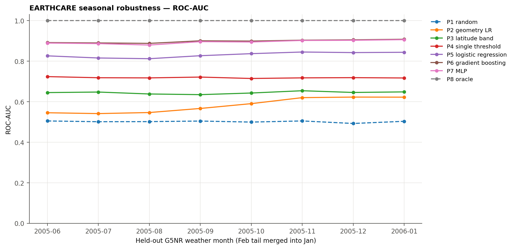

Per-month AUC; P8 is an oracle reference.

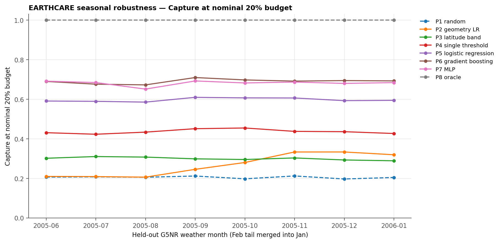

Per-month capture at nominal 20%; see realized duty below.

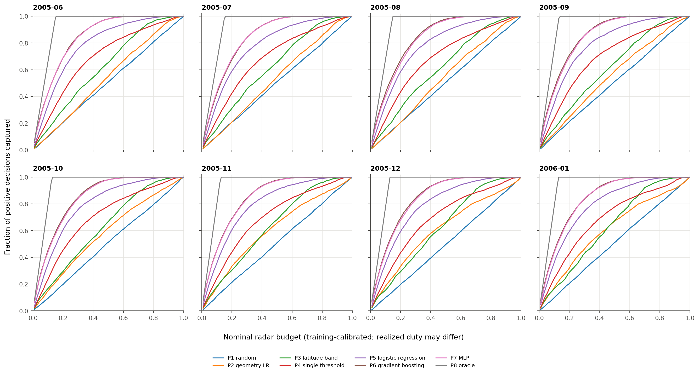

Independent capture curves for all held-out months and policies.

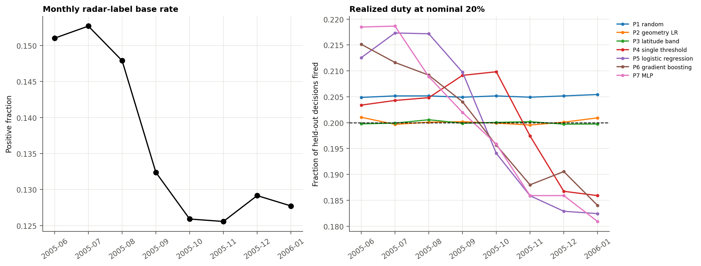

Monthly base rate and realized duty at nominal 20%.

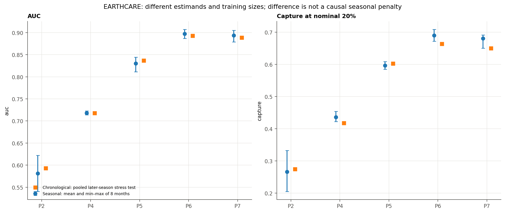

Chronological stress test versus equal-weight seasonal mean and range; different estimands.

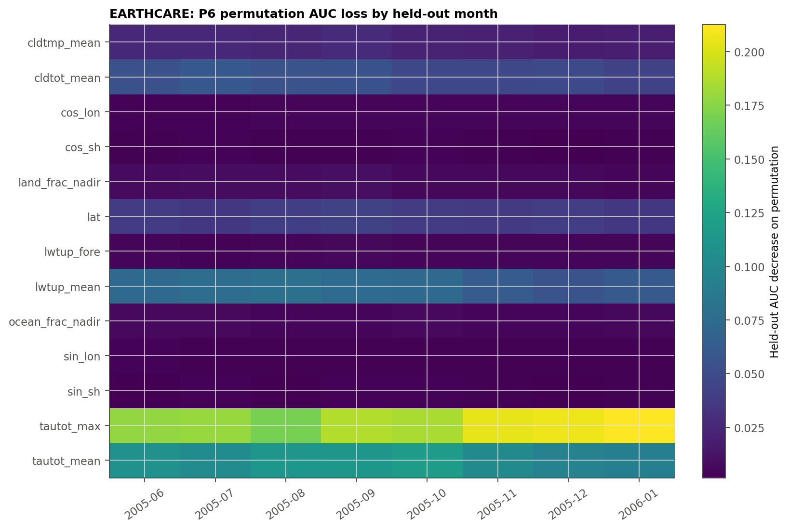

P6 fixed in advance: held-out permutation importance by month.

## TRMM

Dataset SHA-256: `fab9c8c7ebbd5fa79ca8220fd69c3b3c1d254e60407c89f09261d7591a7e9c01`; seed `0`; threshold source `training_months_in_sample_score_quantile`. Source: `missions/trmm/results/seasonal_lomo/`.

### Per-month scores at nominal 20% budget

| held_out_month | policy | n_test | base_rate | auc | average_precision | capture | mass_capture | precision | realized_duty |
| --- | --- | --- | --- | --- | --- | --- | --- | --- | --- |
| 2005-06 | P1 random | 42240 | 0.4389 | 0.4980 | 0.4388 | 0.2062 | 0.2011 | 0.4418 | 0.2049 |
| 2005-06 | P2 geometry LR | 42240 | 0.4389 | 0.5951 | 0.5030 | 0.2309 | 0.2407 | 0.5255 | 0.1928 |
| 2005-06 | P3 latitude band | 42240 | 0.4389 | 0.5426 | 0.5037 | 0.2516 | 0.2983 | 0.5527 | 0.1998 |
| 2005-06 | P4 single threshold | 42240 | 0.4389 | 0.6982 | 0.5913 | 0.2822 | 0.4566 | 0.6279 | 0.1972 |
| 2005-06 | P5 logistic regression | 42240 | 0.4389 | 0.8078 | 0.7302 | 0.3693 | 0.6178 | 0.7842 | 0.2067 |
| 2005-06 | P6 gradient boosting | 42240 | 0.4389 | 0.8600 | 0.8095 | 0.3907 | 0.6249 | 0.8470 | 0.2024 |
| 2005-06 | P7 MLP | 42240 | 0.4389 | 0.8582 | 0.8101 | 0.3961 | 0.6207 | 0.8465 | 0.2053 |
| 2005-06 | P8 oracle | 42240 | 0.4389 | 1.0000 | 1.0000 | 0.4557 | 0.8071 | 1.0000 | 0.2000 |
| 2005-07 | P1 random | 44580 | 0.4475 | 0.4972 | 0.4437 | 0.1989 | 0.1909 | 0.4340 | 0.2052 |
| 2005-07 | P2 geometry LR | 44580 | 0.4475 | 0.5817 | 0.5070 | 0.2448 | 0.2210 | 0.5229 | 0.2096 |
| 2005-07 | P3 latitude band | 44580 | 0.4475 | 0.5505 | 0.5090 | 0.2516 | 0.3285 | 0.5624 | 0.2002 |
| 2005-07 | P4 single threshold | 44580 | 0.4475 | 0.7018 | 0.6166 | 0.3159 | 0.5029 | 0.6531 | 0.2164 |
| 2005-07 | P5 logistic regression | 44580 | 0.4475 | 0.7992 | 0.7335 | 0.4157 | 0.6699 | 0.7781 | 0.2391 |
| 2005-07 | P6 gradient boosting | 44580 | 0.4475 | 0.8648 | 0.8220 | 0.4543 | 0.6841 | 0.8501 | 0.2391 |
| 2005-07 | P7 MLP | 44580 | 0.4475 | 0.8642 | 0.8215 | 0.4563 | 0.6671 | 0.8502 | 0.2402 |
| 2005-07 | P8 oracle | 44580 | 0.4475 | 1.0000 | 1.0000 | 0.4469 | 0.7829 | 1.0000 | 0.2000 |
| 2005-08 | P1 random | 44580 | 0.4183 | 0.5010 | 0.4209 | 0.2050 | 0.2129 | 0.4179 | 0.2052 |
| 2005-08 | P2 geometry LR | 44580 | 0.4183 | 0.5795 | 0.4833 | 0.2288 | 0.2191 | 0.4970 | 0.1926 |
| 2005-08 | P3 latitude band | 44580 | 0.4183 | 0.5666 | 0.4927 | 0.2609 | 0.3410 | 0.5463 | 0.1998 |
| 2005-08 | P4 single threshold | 44580 | 0.4183 | 0.6918 | 0.5817 | 0.3397 | 0.5402 | 0.6177 | 0.2300 |
| 2005-08 | P5 logistic regression | 44580 | 0.4183 | 0.8000 | 0.7083 | 0.3759 | 0.6309 | 0.7589 | 0.2072 |
| 2005-08 | P6 gradient boosting | 44580 | 0.4183 | 0.8639 | 0.8052 | 0.4020 | 0.6374 | 0.8533 | 0.1971 |
| 2005-08 | P7 MLP | 44580 | 0.4183 | 0.8617 | 0.8035 | 0.4044 | 0.6209 | 0.8507 | 0.1988 |
| 2005-08 | P8 oracle | 44580 | 0.4183 | 1.0000 | 1.0000 | 0.4781 | 0.7905 | 1.0000 | 0.2000 |
| 2005-09 | P1 random | 43140 | 0.3959 | 0.5003 | 0.3953 | 0.2063 | 0.2043 | 0.3986 | 0.2049 |
| 2005-09 | P2 geometry LR | 43140 | 0.3959 | 0.5961 | 0.4857 | 0.2668 | 0.2320 | 0.5268 | 0.2005 |
| 2005-09 | P3 latitude band | 43140 | 0.3959 | 0.5490 | 0.4537 | 0.2553 | 0.3140 | 0.5059 | 0.1998 |
| 2005-09 | P4 single threshold | 43140 | 0.3959 | 0.6967 | 0.5639 | 0.2936 | 0.4899 | 0.6058 | 0.1919 |
| 2005-09 | P5 logistic regression | 43140 | 0.3959 | 0.8167 | 0.7119 | 0.3706 | 0.6465 | 0.7711 | 0.1903 |
| 2005-09 | P6 gradient boosting | 43140 | 0.3959 | 0.8739 | 0.8097 | 0.3977 | 0.6386 | 0.8593 | 0.1832 |
| 2005-09 | P7 MLP | 43140 | 0.3959 | 0.8685 | 0.8000 | 0.3818 | 0.5991 | 0.8525 | 0.1773 |
| 2005-09 | P8 oracle | 43140 | 0.3959 | 1.0000 | 1.0000 | 0.5052 | 0.8143 | 1.0000 | 0.2000 |
| 2005-10 | P1 random | 44580 | 0.3966 | 0.5050 | 0.4003 | 0.2093 | 0.2042 | 0.4045 | 0.2052 |
| 2005-10 | P2 geometry LR | 44580 | 0.3966 | 0.5757 | 0.4629 | 0.2577 | 0.2510 | 0.4979 | 0.2053 |
| 2005-10 | P3 latitude band | 44580 | 0.3966 | 0.5627 | 0.4620 | 0.2497 | 0.3086 | 0.4951 | 0.2000 |
| 2005-10 | P4 single threshold | 44580 | 0.3966 | 0.6973 | 0.5635 | 0.2975 | 0.4785 | 0.6031 | 0.1956 |
| 2005-10 | P5 logistic regression | 44580 | 0.3966 | 0.8115 | 0.7155 | 0.3420 | 0.6026 | 0.7908 | 0.1715 |
| 2005-10 | P6 gradient boosting | 44580 | 0.3966 | 0.8696 | 0.8036 | 0.3841 | 0.6168 | 0.8623 | 0.1766 |
| 2005-10 | P7 MLP | 44580 | 0.3966 | 0.8643 | 0.7951 | 0.3805 | 0.6039 | 0.8487 | 0.1778 |
| 2005-10 | P8 oracle | 44580 | 0.3966 | 1.0000 | 1.0000 | 0.5043 | 0.8081 | 1.0000 | 0.2000 |
| 2005-11 | P1 random | 43140 | 0.3973 | 0.4971 | 0.3944 | 0.2038 | 0.2007 | 0.3951 | 0.2049 |
| 2005-11 | P2 geometry LR | 43140 | 0.3973 | 0.6060 | 0.4977 | 0.2650 | 0.2816 | 0.5469 | 0.1925 |
| 2005-11 | P3 latitude band | 43140 | 0.3973 | 0.5607 | 0.4671 | 0.2579 | 0.3351 | 0.5123 | 0.2000 |
| 2005-11 | P4 single threshold | 43140 | 0.3973 | 0.6884 | 0.5586 | 0.2910 | 0.4760 | 0.5909 | 0.1956 |
| 2005-11 | P5 logistic regression | 43140 | 0.3973 | 0.8267 | 0.7297 | 0.3773 | 0.6379 | 0.7870 | 0.1905 |
| 2005-11 | P6 gradient boosting | 43140 | 0.3973 | 0.8765 | 0.8094 | 0.3709 | 0.6175 | 0.8626 | 0.1708 |
| 2005-11 | P7 MLP | 43140 | 0.3973 | 0.8736 | 0.8061 | 0.3803 | 0.6044 | 0.8574 | 0.1762 |
| 2005-11 | P8 oracle | 43140 | 0.3973 | 1.0000 | 1.0000 | 0.5034 | 0.8204 | 1.0000 | 0.2000 |
| 2005-12 | P1 random | 44580 | 0.4219 | 0.5015 | 0.4219 | 0.2036 | 0.2064 | 0.4187 | 0.2052 |
| 2005-12 | P2 geometry LR | 44580 | 0.4219 | 0.5926 | 0.5050 | 0.2618 | 0.2756 | 0.5440 | 0.2031 |
| 2005-12 | P3 latitude band | 44580 | 0.4219 | 0.5555 | 0.4846 | 0.2529 | 0.3404 | 0.5333 | 0.2000 |
| 2005-12 | P4 single threshold | 44580 | 0.4219 | 0.7307 | 0.6255 | 0.2942 | 0.4780 | 0.6763 | 0.1835 |
| 2005-12 | P5 logistic regression | 44580 | 0.4219 | 0.8230 | 0.7477 | 0.3830 | 0.6322 | 0.8061 | 0.2004 |
| 2005-12 | P6 gradient boosting | 44580 | 0.4219 | 0.8727 | 0.8184 | 0.4154 | 0.6414 | 0.8533 | 0.2054 |
| 2005-12 | P7 MLP | 44580 | 0.4219 | 0.8716 | 0.8159 | 0.4100 | 0.6265 | 0.8585 | 0.2015 |
| 2005-12 | P8 oracle | 44580 | 0.4219 | 1.0000 | 1.0000 | 0.4740 | 0.7986 | 1.0000 | 0.2000 |
| 2006-01 | P1 random | 45480 | 0.4126 | 0.5036 | 0.4149 | 0.2060 | 0.2075 | 0.4137 | 0.2054 |
| 2006-01 | P2 geometry LR | 45480 | 0.4126 | 0.5917 | 0.5008 | 0.2649 | 0.2774 | 0.5321 | 0.2054 |
| 2006-01 | P3 latitude band | 45480 | 0.4126 | 0.5500 | 0.4670 | 0.2445 | 0.2980 | 0.5048 | 0.1999 |
| 2006-01 | P4 single threshold | 45480 | 0.4126 | 0.6933 | 0.5744 | 0.2793 | 0.4689 | 0.6016 | 0.1916 |
| 2006-01 | P5 logistic regression | 45480 | 0.4126 | 0.8269 | 0.7471 | 0.3875 | 0.6395 | 0.8029 | 0.1991 |
| 2006-01 | P6 gradient boosting | 45480 | 0.4126 | 0.8667 | 0.8004 | 0.4021 | 0.6396 | 0.8315 | 0.1995 |
| 2006-01 | P7 MLP | 45480 | 0.4126 | 0.8662 | 0.8019 | 0.4236 | 0.6361 | 0.8381 | 0.2086 |
| 2006-01 | P8 oracle | 45480 | 0.4126 | 1.0000 | 1.0000 | 0.4847 | 0.8078 | 1.0000 | 0.2000 |

### Equal-weight mean, SD and range across months

| policy | auc_mean | auc_std | auc_min | auc_max | capture_mean | capture_std | capture_min | capture_max | realized_duty_min | realized_duty_max |
| --- | --- | --- | --- | --- | --- | --- | --- | --- | --- | --- |
| P1 random | 0.5005 | 0.0029 | 0.4971 | 0.5050 | 0.2049 | 0.0030 | 0.1989 | 0.2093 | 0.2049 | 0.2054 |
| P2 geometry LR | 0.5898 | 0.0101 | 0.5757 | 0.6060 | 0.2526 | 0.0157 | 0.2288 | 0.2668 | 0.1925 | 0.2096 |
| P3 latitude band | 0.5547 | 0.0081 | 0.5426 | 0.5666 | 0.2531 | 0.0051 | 0.2445 | 0.2609 | 0.1998 | 0.2002 |
| P4 single threshold | 0.6998 | 0.0132 | 0.6884 | 0.7307 | 0.2992 | 0.0197 | 0.2793 | 0.3397 | 0.1835 | 0.2300 |
| P5 logistic regression | 0.8140 | 0.0112 | 0.7992 | 0.8269 | 0.3777 | 0.0206 | 0.3420 | 0.4157 | 0.1715 | 0.2391 |
| P6 gradient boosting | 0.8685 | 0.0056 | 0.8600 | 0.8765 | 0.4022 | 0.0249 | 0.3709 | 0.4543 | 0.1708 | 0.2391 |
| P7 MLP | 0.8660 | 0.0051 | 0.8582 | 0.8736 | 0.4041 | 0.0263 | 0.3803 | 0.4563 | 0.1762 | 0.2402 |
| P8 oracle | 1.0000 | 0.0000 | 1.0000 | 1.0000 | 0.4816 | 0.0224 | 0.4469 | 0.5052 | 0.2000 | 0.2000 |

### Monthly block-bootstrap intervals

Whole-day resampling is performed separately within each month with fixed gates. Below are the P6 intervals; all policies and metrics are in `e10_bootstrap.csv`. Across-fold summaries of interval endpoints are descriptive, not confidence intervals for a pooled all-season score.

| held_out_month | metric | mean | ci_low | ci_high | n_boot |
| --- | --- | --- | --- | --- | --- |
| 2005-06 | auc | 0.8600 | 0.8550 | 0.8651 | 1000 |
| 2005-06 | capture@20% | 0.3906 | 0.3816 | 0.3997 | 1000 |
| 2005-07 | auc | 0.8649 | 0.8604 | 0.8694 | 1000 |
| 2005-07 | capture@20% | 0.4542 | 0.4436 | 0.4642 | 1000 |
| 2005-08 | auc | 0.8638 | 0.8592 | 0.8678 | 1000 |
| 2005-08 | capture@20% | 0.4018 | 0.3838 | 0.4205 | 1000 |
| 2005-09 | auc | 0.8739 | 0.8709 | 0.8772 | 1000 |
| 2005-09 | capture@20% | 0.3976 | 0.3843 | 0.4102 | 1000 |
| 2005-10 | auc | 0.8696 | 0.8653 | 0.8735 | 1000 |
| 2005-10 | capture@20% | 0.3841 | 0.3753 | 0.3928 | 1000 |
| 2005-11 | auc | 0.8764 | 0.8709 | 0.8817 | 1000 |
| 2005-11 | capture@20% | 0.3708 | 0.3597 | 0.3806 | 1000 |
| 2005-12 | auc | 0.8726 | 0.8684 | 0.8771 | 1000 |
| 2005-12 | capture@20% | 0.4151 | 0.4012 | 0.4282 | 1000 |
| 2006-01 | auc | 0.8668 | 0.8620 | 0.8722 | 1000 |
| 2006-01 | capture@20% | 0.4023 | 0.3932 | 0.4114 | 1000 |

### Additional seasonal analyses

### E4: geometry by training and scoring label

| variable | trained_on | scored_on | auc_mean | capture_mean | capture_min | capture_max | precision_mean | base_rate_mean |
| --- | --- | --- | --- | --- | --- | --- | --- | --- |
| preccon | preccon_nadir | preccon_nadir | 0.9089 | 0.8503 | 0.8323 | 0.8724 | 0.0844 | 0.0199 |
| preccon | preccon_nadir | preccon_radar | 0.9114 | 0.7532 | 0.7367 | 0.7693 | 0.4360 | 0.1158 |
| preccon | preccon_nadir | preccon_swath | 0.9223 | 0.6358 | 0.6134 | 0.6496 | 0.7445 | 0.2343 |
| preccon | preccon_radar | preccon_nadir | 0.9140 | 0.8599 | 0.8365 | 0.8859 | 0.0862 | 0.0199 |
| preccon | preccon_radar | preccon_radar | 0.9189 | 0.7650 | 0.7347 | 0.7834 | 0.4474 | 0.1158 |
| preccon | preccon_radar | preccon_swath | 0.9307 | 0.6431 | 0.6105 | 0.6597 | 0.7609 | 0.2343 |
| preccon | preccon_swath | preccon_nadir | 0.9113 | 0.8531 | 0.8368 | 0.8712 | 0.0856 | 0.0199 |
| preccon | preccon_swath | preccon_radar | 0.9167 | 0.7576 | 0.7307 | 0.7832 | 0.4432 | 0.1158 |
| preccon | preccon_swath | preccon_swath | 0.9342 | 0.6489 | 0.6227 | 0.6686 | 0.7679 | 0.2343 |
| prectot | prectot_nadir | prectot_nadir | 0.8485 | 0.5856 | 0.5587 | 0.6292 | 0.4403 | 0.1493 |
| prectot | prectot_nadir | prectot_radar | 0.8607 | 0.4009 | 0.3756 | 0.4374 | 0.8401 | 0.4161 |
| prectot | prectot_nadir | prectot_swath | 0.9004 | 0.3020 | 0.2770 | 0.3383 | 0.9715 | 0.6391 |
| prectot | prectot_radar | prectot_nadir | 0.8446 | 0.5701 | 0.5347 | 0.6322 | 0.4334 | 0.1493 |
| prectot | prectot_radar | prectot_radar | 0.8685 | 0.4022 | 0.3709 | 0.4543 | 0.8524 | 0.4161 |
| prectot | prectot_radar | prectot_swath | 0.9080 | 0.3007 | 0.2731 | 0.3482 | 0.9786 | 0.6391 |
| prectot | prectot_swath | prectot_nadir | 0.8327 | 0.5452 | 0.5202 | 0.5874 | 0.4140 | 0.1493 |
| prectot | prectot_swath | prectot_radar | 0.8593 | 0.3920 | 0.3748 | 0.4232 | 0.8302 | 0.4161 |
| prectot | prectot_swath | prectot_swath | 0.9123 | 0.3006 | 0.2823 | 0.3310 | 0.9777 | 0.6391 |

### E5: tiers and illumination at nominal 20%

| tier | regime | capture_mean | capture_std | capture_min | capture_max | realized_duty_mean |
| --- | --- | --- | --- | --- | --- | --- |
| A | day | 0.4061 | 0.0275 | 0.3717 | 0.4535 | 0.1963 |
| A | night | NA | NA | NA | NA | NA |
| A | switched | 0.3808 | 0.0131 | 0.3617 | 0.4015 | 0.1951 |
| A_notau | day | 0.3712 | 0.0237 | 0.3163 | 0.3883 | 0.1964 |
| A_notau | night | 0.3531 | 0.0110 | 0.3324 | 0.3673 | 0.1928 |
| A_notau | switched | 0.3624 | 0.0120 | 0.3368 | 0.3751 | 0.1944 |
| B | day | 0.3683 | 0.0237 | 0.3171 | 0.3962 | 0.1997 |
| B | night | 0.3493 | 0.0156 | 0.3304 | 0.3686 | 0.1958 |
| B | switched | 0.3585 | 0.0164 | 0.3273 | 0.3762 | 0.1976 |
| C | day | 0.3184 | 0.0256 | 0.2802 | 0.3654 | 0.1996 |
| C | night | 0.3136 | 0.0287 | 0.2759 | 0.3549 | 0.2005 |
| C | switched | 0.3163 | 0.0214 | 0.2822 | 0.3440 | 0.2000 |

### E6: global thresholds within strata at nominal 20%

| stratum | auc_mean | capture_mean | capture_min | capture_max | realized_duty_min | realized_duty_max |
| --- | --- | --- | --- | --- | --- | --- |
| deep tropics /lat/<10 | 0.8545 | 0.4852 | 0.4545 | 0.5269 | 0.2511 | 0.3011 |
| land | 0.9313 | 0.5006 | 0.4183 | 0.5844 | 0.1339 | 0.2370 |
| mixed | 0.9041 | 0.5753 | 0.5259 | 0.6207 | 0.2467 | 0.3372 |
| ocean | 0.8354 | 0.3519 | 0.3314 | 0.3971 | 0.1667 | 0.2233 |
| outer tropics 10-23.5 | 0.8649 | 0.4135 | 0.3524 | 0.4519 | 0.1887 | 0.2522 |
| subtropics >=23.5 | 0.8720 | 0.3514 | 0.3034 | 0.4360 | 0.1215 | 0.2101 |

### E7: label sensitivity at nominal 20%

| policy | label | auc_mean | average_precision_mean | capture_mean | capture_min | capture_max | base_rate_mean |
| --- | --- | --- | --- | --- | --- | --- | --- |
| P5 logistic regression | convective_1_mm_hr | 0.8926 | 0.4742 | 0.7138 | 0.6834 | 0.7510 | 0.1158 |
| P5 logistic regression | rain_0.1_mm_hr | 0.9173 | 0.9669 | 0.2641 | 0.2355 | 0.3050 | 0.7506 |
| P5 logistic regression | rain_1_mm_hr | 0.8140 | 0.7280 | 0.3777 | 0.3420 | 0.4157 | 0.4161 |
| P5 logistic regression | rain_5_mm_hr | 0.8372 | 0.5714 | 0.5273 | 0.4980 | 0.5671 | 0.2174 |
| P5 logistic regression | training_median_split | 0.8330 | 0.8066 | 0.3457 | 0.3094 | 0.3808 | 0.4999 |
| P6 gradient boosting | convective_1_mm_hr | 0.9189 | 0.5842 | 0.7650 | 0.7347 | 0.7834 | 0.1158 |
| P6 gradient boosting | rain_0.1_mm_hr | 0.9446 | 0.9795 | 0.2640 | 0.2534 | 0.2794 | 0.7506 |
| P6 gradient boosting | rain_1_mm_hr | 0.8685 | 0.8098 | 0.4022 | 0.3709 | 0.4543 | 0.4161 |
| P6 gradient boosting | rain_5_mm_hr | 0.8777 | 0.6565 | 0.5696 | 0.5459 | 0.6086 | 0.2174 |
| P6 gradient boosting | training_median_split | 0.8799 | 0.8670 | 0.3589 | 0.3414 | 0.4036 | 0.4999 |

### E11: monthly importance mean and range

| feature | auc_drop_mean_mean | auc_drop_mean_std | auc_drop_mean_min | auc_drop_mean_max |
| --- | --- | --- | --- | --- |
| cldtmp_mean | 0.0401 | 0.0058 | 0.0329 | 0.0477 |
| cldtot_mean | 0.0593 | 0.0051 | 0.0502 | 0.0664 |
| cos_lon | 0.0073 | 0.0016 | 0.0048 | 0.0095 |
| cos_sh | 0.0026 | 0.0007 | 0.0016 | 0.0039 |
| land_frac_nadir | 0.0194 | 0.0042 | 0.0125 | 0.0244 |
| lat | 0.0180 | 0.0046 | 0.0087 | 0.0214 |
| lwtup_mean | 0.0491 | 0.0052 | 0.0394 | 0.0537 |
| ocean_frac_nadir | 0.0075 | 0.0022 | 0.0042 | 0.0104 |
| sin_lon | 0.0092 | 0.0016 | 0.0065 | 0.0109 |
| sin_sh | 0.0026 | 0.0006 | 0.0019 | 0.0038 |
| tautot_max | 0.0699 | 0.0066 | 0.0634 | 0.0820 |
| tautot_mean | 0.1625 | 0.0070 | 0.1540 | 0.1726 |

### Seasonal figures

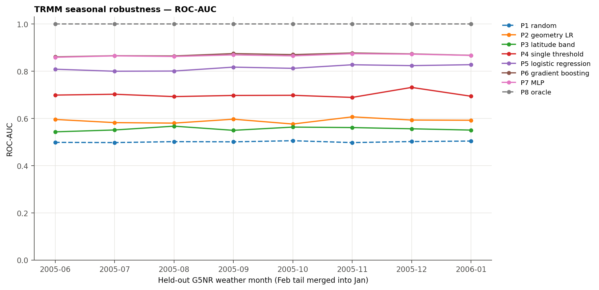

Per-month AUC; P8 is an oracle reference.

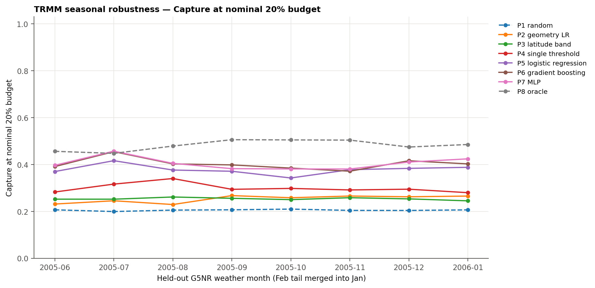

Per-month capture at nominal 20%; see realized duty below.

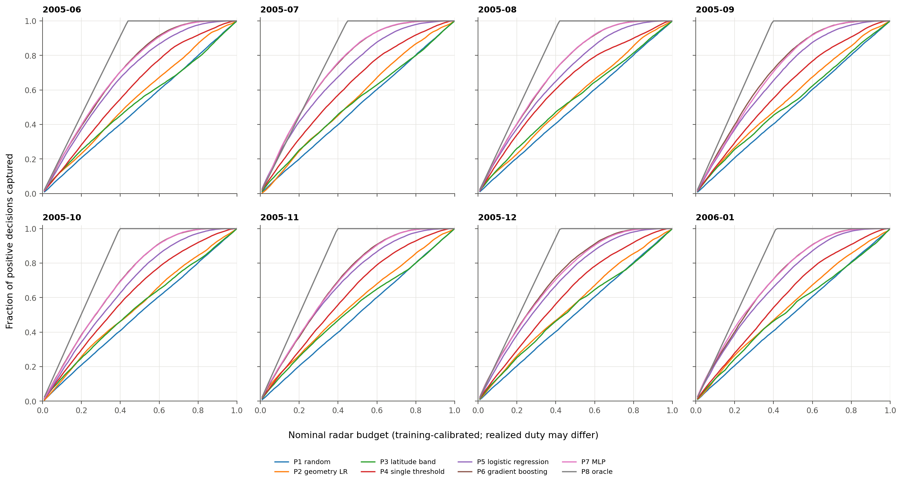

Independent capture curves for all held-out months and policies.

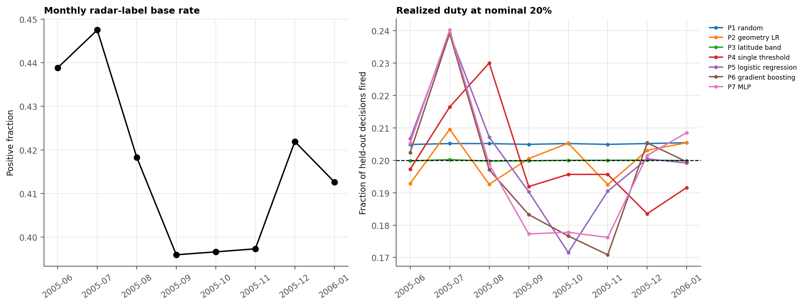

Monthly base rate and realized duty at nominal 20%.

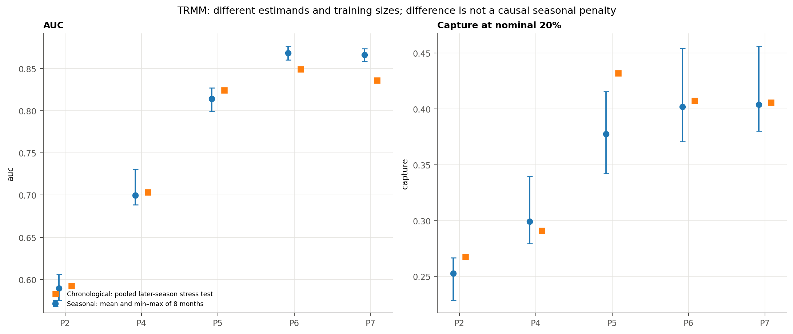

Chronological stress test versus equal-weight seasonal mean and range; different estimands.

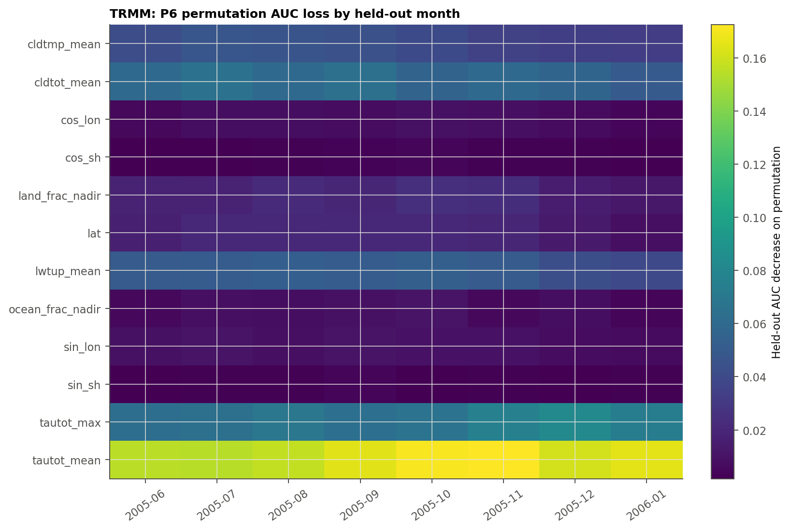

P6 fixed in advance: held-out permutation importance by month.

## E12: matched seasonal comparison

Both missions hold out the same G5NR weather month and restrict fitting, calibration and testing to |latitude| <= 35.2 degrees. The primary labels remain mission-specific; these scores are not a common-footprint instrument contest. The same G5NR weather limits independence.

| mission | held_out_month | policy | base_rate | auc | average_precision | capture | mass_capture | realized_duty |
| --- | --- | --- | --- | --- | --- | --- | --- | --- |
| earthcare | 2005-06 | P5 logistic regression | 0.1864 | 0.8240 | 0.5176 | 0.5518 | 0.6600 | 0.2041 |
| earthcare | 2005-06 | P6 gradient boosting | 0.1864 | 0.8673 | 0.6055 | 0.5962 | 0.6573 | 0.2053 |
| earthcare | 2005-06 | P7 MLP | 0.1864 | 0.8594 | 0.5750 | 0.5826 | 0.6412 | 0.2066 |
| earthcare | 2005-06 | P6 Tier B | 0.1864 | 0.8067 | 0.5077 | 0.5233 | 0.6084 | 0.2096 |
| trmm | 2005-06 | P5 logistic regression | 0.4390 | 0.8077 | 0.7301 | 0.3690 | 0.6166 | 0.2066 |
| trmm | 2005-06 | P6 gradient boosting | 0.4390 | 0.8600 | 0.8092 | 0.3889 | 0.6202 | 0.2011 |
| trmm | 2005-06 | P7 MLP | 0.4390 | 0.8580 | 0.8103 | 0.3937 | 0.6083 | 0.2023 |
| trmm | 2005-06 | P6 Tier B | 0.4390 | 0.7877 | 0.7213 | 0.3726 | 0.6101 | 0.2166 |
| earthcare | 2005-07 | P5 logistic regression | 0.1807 | 0.8124 | 0.4838 | 0.5425 | 0.6781 | 0.2042 |
| earthcare | 2005-07 | P6 gradient boosting | 0.1807 | 0.8671 | 0.6004 | 0.6099 | 0.6912 | 0.2095 |
| earthcare | 2005-07 | P7 MLP | 0.1807 | 0.8621 | 0.5827 | 0.6074 | 0.7039 | 0.2102 |
| earthcare | 2005-07 | P6 Tier B | 0.1807 | 0.8114 | 0.5175 | 0.5191 | 0.6284 | 0.1978 |
| trmm | 2005-07 | P5 logistic regression | 0.4478 | 0.7991 | 0.7335 | 0.4152 | 0.6694 | 0.2390 |
| trmm | 2005-07 | P6 gradient boosting | 0.4478 | 0.8645 | 0.8214 | 0.4529 | 0.6820 | 0.2392 |
| trmm | 2005-07 | P7 MLP | 0.4478 | 0.8607 | 0.8162 | 0.4447 | 0.6547 | 0.2349 |
| trmm | 2005-07 | P6 Tier B | 0.4478 | 0.7910 | 0.7384 | 0.3462 | 0.5703 | 0.1995 |
| earthcare | 2005-08 | P5 logistic regression | 0.1754 | 0.8157 | 0.4840 | 0.5176 | 0.6576 | 0.1916 |
| earthcare | 2005-08 | P6 gradient boosting | 0.1754 | 0.8713 | 0.6034 | 0.5930 | 0.6587 | 0.1972 |
| earthcare | 2005-08 | P7 MLP | 0.1754 | 0.8658 | 0.5771 | 0.5917 | 0.6715 | 0.2019 |
| earthcare | 2005-08 | P6 Tier B | 0.1754 | 0.8116 | 0.5129 | 0.5020 | 0.5900 | 0.1862 |
| trmm | 2005-08 | P5 logistic regression | 0.4184 | 0.7999 | 0.7082 | 0.3758 | 0.6309 | 0.2072 |
| trmm | 2005-08 | P6 gradient boosting | 0.4184 | 0.8635 | 0.8049 | 0.4029 | 0.6390 | 0.1984 |
| trmm | 2005-08 | P7 MLP | 0.4184 | 0.8602 | 0.7995 | 0.3985 | 0.6302 | 0.1980 |
| trmm | 2005-08 | P6 Tier B | 0.4184 | 0.7954 | 0.7264 | 0.3313 | 0.5637 | 0.1762 |
| earthcare | 2005-09 | P5 logistic regression | 0.1629 | 0.8347 | 0.5003 | 0.5301 | 0.6744 | 0.1789 |
| earthcare | 2005-09 | P6 gradient boosting | 0.1629 | 0.8830 | 0.6136 | 0.6118 | 0.7001 | 0.1835 |
| earthcare | 2005-09 | P7 MLP | 0.1629 | 0.8754 | 0.5865 | 0.6020 | 0.6887 | 0.1865 |
| earthcare | 2005-09 | P6 Tier B | 0.1629 | 0.8320 | 0.5148 | 0.5366 | 0.6653 | 0.1847 |
| trmm | 2005-09 | P5 logistic regression | 0.3959 | 0.8167 | 0.7120 | 0.3710 | 0.6470 | 0.1904 |
| trmm | 2005-09 | P6 gradient boosting | 0.3959 | 0.8742 | 0.8100 | 0.3985 | 0.6389 | 0.1836 |
| trmm | 2005-09 | P7 MLP | 0.3959 | 0.8702 | 0.8002 | 0.3875 | 0.6164 | 0.1815 |
| trmm | 2005-09 | P6 Tier B | 0.3959 | 0.8123 | 0.7252 | 0.3517 | 0.5891 | 0.1806 |
| earthcare | 2005-10 | P5 logistic regression | 0.1615 | 0.8337 | 0.4801 | 0.5393 | 0.6679 | 0.1841 |
| earthcare | 2005-10 | P6 gradient boosting | 0.1615 | 0.8739 | 0.5742 | 0.5817 | 0.6561 | 0.1805 |
| earthcare | 2005-10 | P7 MLP | 0.1615 | 0.8679 | 0.5598 | 0.5771 | 0.6654 | 0.1794 |
| earthcare | 2005-10 | P6 Tier B | 0.1615 | 0.8218 | 0.4931 | 0.5315 | 0.6208 | 0.1901 |
| trmm | 2005-10 | P5 logistic regression | 0.3966 | 0.8115 | 0.7155 | 0.3424 | 0.6029 | 0.1717 |
| trmm | 2005-10 | P6 gradient boosting | 0.3966 | 0.8700 | 0.8041 | 0.3826 | 0.6150 | 0.1762 |
| trmm | 2005-10 | P7 MLP | 0.3966 | 0.8649 | 0.7965 | 0.3785 | 0.5882 | 0.1760 |
| trmm | 2005-10 | P6 Tier B | 0.3966 | 0.8013 | 0.7165 | 0.3759 | 0.5924 | 0.1950 |
| earthcare | 2005-11 | P5 logistic regression | 0.1676 | 0.8344 | 0.4998 | 0.5627 | 0.6868 | 0.1977 |
| earthcare | 2005-11 | P6 gradient boosting | 0.1676 | 0.8749 | 0.5886 | 0.5920 | 0.6911 | 0.1891 |
| earthcare | 2005-11 | P7 MLP | 0.1676 | 0.8672 | 0.5629 | 0.5775 | 0.6820 | 0.1854 |
| earthcare | 2005-11 | P6 Tier B | 0.1676 | 0.8105 | 0.4767 | 0.5162 | 0.6061 | 0.1971 |
| trmm | 2005-11 | P5 logistic regression | 0.3973 | 0.8266 | 0.7296 | 0.3772 | 0.6377 | 0.1904 |
| trmm | 2005-11 | P6 gradient boosting | 0.3973 | 0.8763 | 0.8096 | 0.3716 | 0.6187 | 0.1710 |
| trmm | 2005-11 | P7 MLP | 0.3973 | 0.8744 | 0.8081 | 0.3844 | 0.6101 | 0.1778 |
| trmm | 2005-11 | P6 Tier B | 0.3973 | 0.8111 | 0.7282 | 0.3727 | 0.6005 | 0.1925 |
| earthcare | 2005-12 | P5 logistic regression | 0.1831 | 0.8295 | 0.5167 | 0.5889 | 0.7122 | 0.2230 |
| earthcare | 2005-12 | P6 gradient boosting | 0.1831 | 0.8646 | 0.5875 | 0.6142 | 0.6843 | 0.2194 |
| earthcare | 2005-12 | P7 MLP | 0.1831 | 0.8563 | 0.5652 | 0.5983 | 0.6655 | 0.2164 |
| earthcare | 2005-12 | P6 Tier B | 0.1831 | 0.7938 | 0.4747 | 0.5152 | 0.6043 | 0.2167 |
| trmm | 2005-12 | P5 logistic regression | 0.4220 | 0.8230 | 0.7478 | 0.3829 | 0.6315 | 0.2005 |
| trmm | 2005-12 | P6 gradient boosting | 0.4220 | 0.8727 | 0.8185 | 0.4168 | 0.6418 | 0.2057 |
| trmm | 2005-12 | P7 MLP | 0.4220 | 0.8721 | 0.8171 | 0.4272 | 0.6382 | 0.2107 |
| trmm | 2005-12 | P6 Tier B | 0.4220 | 0.7863 | 0.7118 | 0.3800 | 0.5883 | 0.2165 |
| earthcare | 2006-01 | P5 logistic regression | 0.1794 | 0.8361 | 0.5187 | 0.5848 | 0.7165 | 0.2174 |
| earthcare | 2006-01 | P6 gradient boosting | 0.1794 | 0.8746 | 0.6025 | 0.6270 | 0.7168 | 0.2119 |
| earthcare | 2006-01 | P7 MLP | 0.1794 | 0.8687 | 0.5854 | 0.6154 | 0.7152 | 0.2100 |
| earthcare | 2006-01 | P6 Tier B | 0.1794 | 0.8026 | 0.4807 | 0.5148 | 0.6084 | 0.2068 |
| trmm | 2006-01 | P5 logistic regression | 0.4129 | 0.8268 | 0.7471 | 0.3872 | 0.6392 | 0.1992 |
| trmm | 2006-01 | P6 gradient boosting | 0.4129 | 0.8663 | 0.8006 | 0.4008 | 0.6368 | 0.1986 |
| trmm | 2006-01 | P7 MLP | 0.4129 | 0.8654 | 0.8007 | 0.4071 | 0.6288 | 0.2011 |
| trmm | 2006-01 | P6 Tier B | 0.4129 | 0.7640 | 0.6800 | 0.3559 | 0.5700 | 0.2077 |

### Transfer: monthly mean and range at nominal 20%

Thresholds use target-side **other-seven-month unlabeled scores**, never held-out labels. Compare each cross-mission row with the corresponding own-mission row using the same features and label setting.

| trained_on | tested_on | label_setting | features | policy | auc_mean | auc_min | auc_max | capture_mean | capture_min | capture_max | realized_duty_mean | realized_duty_min | realized_duty_max |
| --- | --- | --- | --- | --- | --- | --- | --- | --- | --- | --- | --- | --- | --- |
| earthcare | earthcare | nadir | geometry only | P5 logistic regression | 0.5652 | 0.5513 | 0.5784 | 0.2402 | 0.2126 | 0.2653 | 0.2001 | 0.1989 | 0.2013 |
| earthcare | earthcare | nadir | geometry only | P6 gradient boosting | 0.7072 | 0.6696 | 0.7530 | 0.3908 | 0.3305 | 0.4528 | 0.1996 | 0.1976 | 0.2028 |
| earthcare | earthcare | nadir | shared cloud + geometry | P5 logistic regression | 0.8270 | 0.8114 | 0.8358 | 0.5517 | 0.5160 | 0.5876 | 0.2005 | 0.1787 | 0.2251 |
| earthcare | earthcare | nadir | shared cloud + geometry | P6 gradient boosting | 0.8713 | 0.8629 | 0.8828 | 0.6008 | 0.5839 | 0.6239 | 0.1994 | 0.1801 | 0.2174 |
| earthcare | earthcare | own radar | geometry only | P5 logistic regression | 0.5652 | 0.5513 | 0.5784 | 0.2402 | 0.2126 | 0.2653 | 0.2001 | 0.1989 | 0.2013 |
| earthcare | earthcare | own radar | geometry only | P6 gradient boosting | 0.7072 | 0.6696 | 0.7530 | 0.3908 | 0.3305 | 0.4528 | 0.1996 | 0.1976 | 0.2028 |
| earthcare | earthcare | own radar | shared cloud + geometry | P5 logistic regression | 0.8270 | 0.8114 | 0.8358 | 0.5517 | 0.5160 | 0.5876 | 0.2005 | 0.1787 | 0.2251 |
| earthcare | earthcare | own radar | shared cloud + geometry | P6 gradient boosting | 0.8713 | 0.8629 | 0.8828 | 0.6008 | 0.5839 | 0.6239 | 0.1994 | 0.1801 | 0.2174 |
| earthcare | trmm | nadir | geometry only | P5 logistic regression | 0.5536 | 0.5373 | 0.5659 | 0.2433 | 0.1978 | 0.2829 | 0.2007 | 0.1977 | 0.2029 |
| earthcare | trmm | nadir | geometry only | P6 gradient boosting | 0.6527 | 0.6142 | 0.6744 | 0.3294 | 0.2705 | 0.3652 | 0.1975 | 0.1748 | 0.2079 |
| earthcare | trmm | nadir | shared cloud + geometry | P5 logistic regression | 0.7973 | 0.7767 | 0.8149 | 0.5272 | 0.5023 | 0.5552 | 0.2003 | 0.1738 | 0.2278 |
| earthcare | trmm | nadir | shared cloud + geometry | P6 gradient boosting | 0.8370 | 0.8276 | 0.8491 | 0.5693 | 0.5490 | 0.5951 | 0.1997 | 0.1788 | 0.2288 |
| earthcare | trmm | own radar | geometry only | P5 logistic regression | 0.5707 | 0.5543 | 0.5853 | 0.2451 | 0.2297 | 0.2666 | 0.2007 | 0.1977 | 0.2029 |
| earthcare | trmm | own radar | geometry only | P6 gradient boosting | 0.6735 | 0.6342 | 0.6973 | 0.2859 | 0.2448 | 0.3073 | 0.1975 | 0.1748 | 0.2079 |
| earthcare | trmm | own radar | shared cloud + geometry | P5 logistic regression | 0.7953 | 0.7792 | 0.8110 | 0.3737 | 0.3442 | 0.4051 | 0.2003 | 0.1738 | 0.2278 |
| earthcare | trmm | own radar | shared cloud + geometry | P6 gradient boosting | 0.8484 | 0.8404 | 0.8567 | 0.3944 | 0.3724 | 0.4200 | 0.1997 | 0.1788 | 0.2288 |
| trmm | earthcare | nadir | geometry only | P5 logistic regression | 0.5627 | 0.5466 | 0.5809 | 0.2433 | 0.2265 | 0.2527 | 0.2002 | 0.1990 | 0.2008 |
| trmm | earthcare | nadir | geometry only | P6 gradient boosting | 0.7027 | 0.6660 | 0.7457 | 0.3831 | 0.3261 | 0.4510 | 0.2002 | 0.1985 | 0.2026 |
| trmm | earthcare | nadir | shared cloud + geometry | P5 logistic regression | 0.8219 | 0.8091 | 0.8302 | 0.5483 | 0.5215 | 0.5883 | 0.2001 | 0.1786 | 0.2259 |
| trmm | earthcare | nadir | shared cloud + geometry | P6 gradient boosting | 0.8669 | 0.8613 | 0.8758 | 0.5924 | 0.5718 | 0.6179 | 0.1993 | 0.1766 | 0.2220 |
| trmm | earthcare | own radar | geometry only | P5 logistic regression | 0.5521 | 0.5320 | 0.5763 | 0.2443 | 0.2211 | 0.2752 | 0.2001 | 0.1989 | 0.2011 |
| trmm | earthcare | own radar | geometry only | P6 gradient boosting | 0.6960 | 0.6670 | 0.7268 | 0.3705 | 0.3283 | 0.4071 | 0.2002 | 0.1990 | 0.2020 |
| trmm | earthcare | own radar | shared cloud + geometry | P5 logistic regression | 0.8218 | 0.8083 | 0.8328 | 0.5275 | 0.5003 | 0.5583 | 0.1999 | 0.1859 | 0.2161 |
| trmm | earthcare | own radar | shared cloud + geometry | P6 gradient boosting | 0.8656 | 0.8603 | 0.8738 | 0.5863 | 0.5651 | 0.6068 | 0.1989 | 0.1785 | 0.2162 |
| trmm | trmm | nadir | geometry only | P5 logistic regression | 0.5569 | 0.5343 | 0.5723 | 0.2445 | 0.2034 | 0.2719 | 0.2008 | 0.1979 | 0.2043 |
| trmm | trmm | nadir | geometry only | P6 gradient boosting | 0.6809 | 0.6457 | 0.7214 | 0.3577 | 0.3055 | 0.4188 | 0.1998 | 0.1901 | 0.2053 |
| trmm | trmm | nadir | shared cloud + geometry | P5 logistic regression | 0.8041 | 0.7851 | 0.8199 | 0.5448 | 0.5242 | 0.5684 | 0.2004 | 0.1739 | 0.2311 |
| trmm | trmm | nadir | shared cloud + geometry | P6 gradient boosting | 0.8485 | 0.8401 | 0.8616 | 0.5857 | 0.5588 | 0.6264 | 0.1988 | 0.1752 | 0.2330 |
| trmm | trmm | own radar | geometry only | P5 logistic regression | 0.5898 | 0.5760 | 0.6059 | 0.2526 | 0.2287 | 0.2671 | 0.2002 | 0.1924 | 0.2096 |
| trmm | trmm | own radar | geometry only | P6 gradient boosting | 0.7208 | 0.6812 | 0.7515 | 0.3198 | 0.2819 | 0.3484 | 0.2005 | 0.1926 | 0.2080 |
| trmm | trmm | own radar | shared cloud + geometry | P5 logistic regression | 0.8139 | 0.7991 | 0.8268 | 0.3776 | 0.3424 | 0.4152 | 0.2006 | 0.1717 | 0.2390 |
| trmm | trmm | own radar | shared cloud + geometry | P6 gradient boosting | 0.8684 | 0.8600 | 0.8763 | 0.4019 | 0.3716 | 0.4529 | 0.1967 | 0.1710 | 0.2392 |
